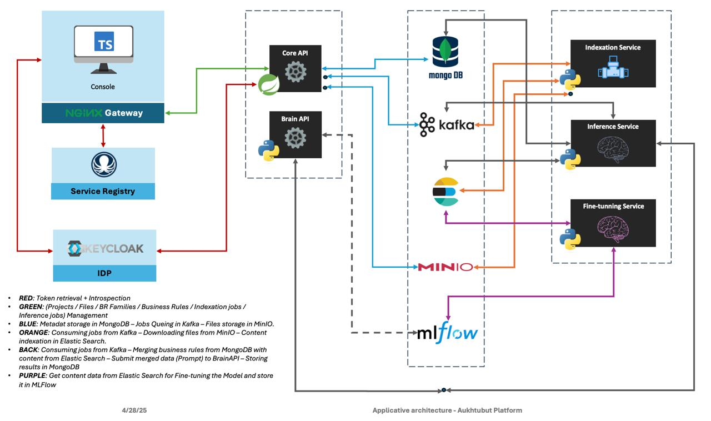

# ✦ Document Intelligence Platform

### Intelligent Document Analysis & Business Rule Automation

  <em>Transforming indexed documents into structured, AI-powered insights.</em>

---

## ✦ Overview

The **Document Intelligence Platform** is an AI-powered document analysis system designed to automate the processing and interpretation of institutional documents.

The platform processes documents such as academic transcripts, enrollment certificates, administrative attestations and formal requests. It combines full-text indexing, configurable business rules and Large Language Models (LLMs) to extract relevant information, evaluate document content and generate structured responses.

By connecting document retrieval with rule-based validation and AI-driven inference, the platform aims to transform unstructured information into actionable, standardized results.

## ✦ System Architecture

The platform follows a distributed, event-driven architecture composed of interconnected services responsible for document storage, indexation, business rule management, inference and user interaction.

  

  <i>Overall system architecture — Final-year project design.</i>

## ✦ Project Scope & Contributions

The project was developed as part of a final-year Licence project by a team of students.

Our implementation focused primarily on the **Inference Service**, which acts as the intelligence layer connecting indexed document content, business rules and Large Language Models.

### Inference Service

- **Dynamic Context Construction:** Retrieves relevant indexed document content and combines it with applicable business rules.
- **Business Rule Processing:** Evaluates configurable conditions and rule mappings stored in MongoDB.
- **LLM Integration:** Connects to cloud-based and local language models to analyse document content and generate responses.
- **Dynamic Prompt Engineering:** Builds contextual prompts using document information, rule conditions and predefined prompt mappings.
- **Structured Output Generation:** Produces standardized JSON responses for downstream processing and institutional workflows.
- **API Integration:** Exposes inference capabilities through backend APIs.

### Wider Platform Architecture

The complete platform architecture also incorporates:

- **Document Indexation:** Elasticsearch for full-text indexing and retrieval, with MinIO for object storage.
- **Asynchronous Processing:** Apache Kafka for coordinating document processing, indexing and inference jobs.
- **Business Rule Management:** MongoDB for storing rule families, dynamic conditions and inference results.
- **Identity & Access Management:** Keycloak for authentication, Single Sign-On (SSO) and role-based access control.
- **Frontend Console:** A TypeScript-based interface for managing projects, documents, rules and processing jobs.
- **Containerization:** Docker for managing the platform's services and deployment environment.

## ✦ Inference Workflow

1. **Retrieve** — The inference service receives a processing request and retrieves the relevant indexed document content.
2. **Match** — Applicable business rules and their associated conditions are identified.
3. **Construct** — Document content, rule conditions and prompt mappings are combined into a contextual prompt.
4. **Infer** — The prepared context is submitted to the selected LLM for analysis.
5. **Structure** — The generated response is validated and formatted into a standardized JSON output.
6. **Store** — Inference results are persisted for further use within the platform.

## ✦ Technology Stack

| Component | Technologies |
|:---|:---|
| Backend & Core Logic | Python, FastAPI |
| Frontend | TypeScript |
| Artificial Intelligence | LLMs, Prompt Engineering |
| Language Models | GPT, Llama 3 |
| Search & Indexation | Elasticsearch |
| Object Storage | MinIO |
| Event Streaming | Apache Kafka |
| Database | MongoDB |
| Identity Management | Keycloak |
| Authentication | OAuth 2.0, JWT, SSO |
| Infrastructure | Docker |
| API Testing | Postman |
| Modeling & Design | UML |

## ✦ Engineering Process

Beyond implementation, the project covered several stages of the software engineering lifecycle:

- Requirements analysis and functional specification.
- Distributed system architecture and service decomposition.
- UML modeling, including use case, sequence, class and activity diagrams.
- Project planning and task organization using Gantt charts.
- REST API design and integration.
- Version control and collaborative development using GitHub.
- API testing and validation using Postman.

## ✦ Project Information

| Detail | Description |
|:---|:---|
| Project | Document Intelligence Platform |
| Academic Level | Licence — Final-Year Project (PFE) |
| Domain | Artificial Intelligence · Distributed Systems |
| Collaboration | Academic project · Team |
| Main Contribution | Inference Service |
| Architecture | Distributed, Event-Driven Architecture |
| Academic Institution | Faculté des Sciences Aïn Chock · Université Hassan II |

---

### ✦ Document Intelligence

*Connecting business knowledge with artificial intelligence.*

**Engineered through collaboration. Driven by intelligent automation.**

